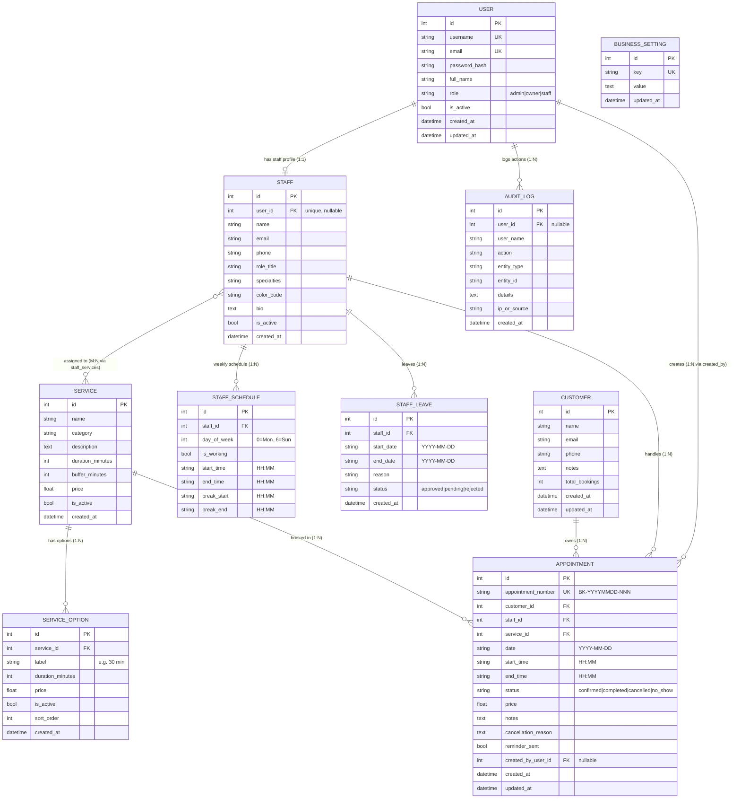
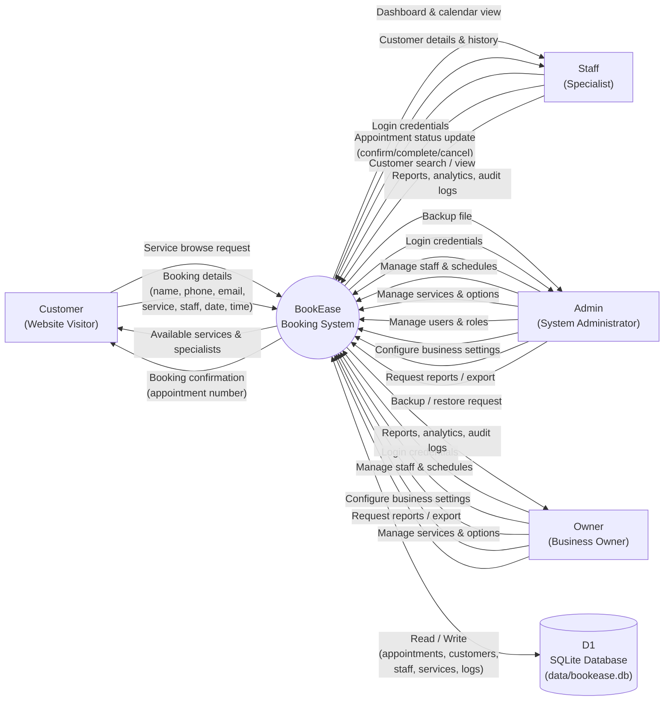
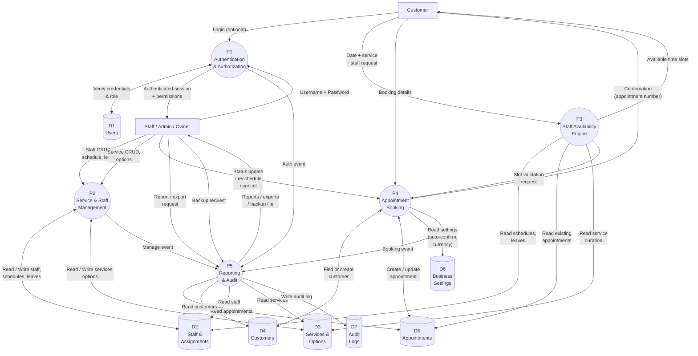
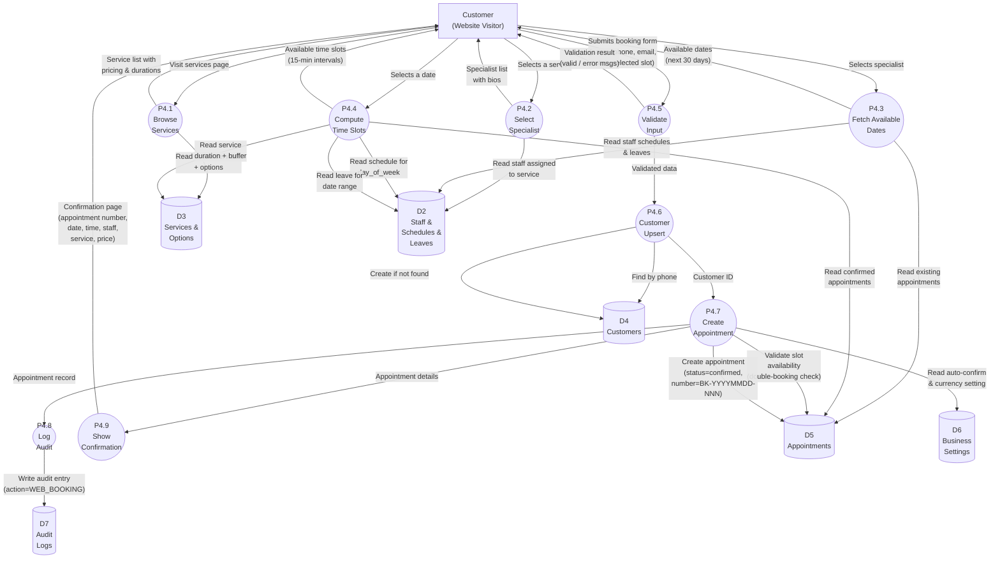
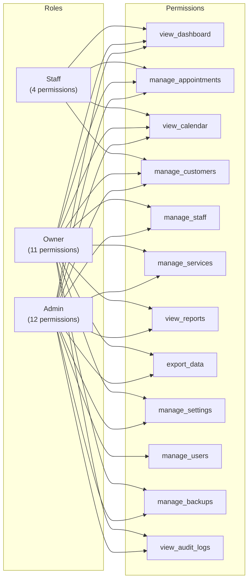

# BookEase — Database & Data-Flow Diagrams

**Project:** BookEase — Professional Universal Booking Management v1.0.0  
**Business:** Lumière Wellness & Spa  
**Database:** SQLite (`data/bookease.db`) — WAL mode, `busy_timeout=5000ms`  
**Generated from:** Actual source code (`src/database/models.py`, `src/config.py`, `src/core/`, `streamlit_app/`)

---

## Table of Contents

1. [Entity Relationship Diagram (ERD)](#1-entity-relationship-diagram-erd)
2. [DFD Level 0 — Context Diagram](#2-dfd-level-0--context-diagram)
3. [DFD Level 1 — Major Subsystems](#3-dfd-level-1--major-subsystems)
4. [DFD Level 2 — Customer Appointment Booking Workflow](#4-dfd-level-2--customer-appointment-booking-workflow)
5. [System Architecture](#5-system-architecture)

---

## 1. Entity Relationship Diagram (ERD)

The BookEase database contains **10 entities** and **1 association table** (`staff_services`) implementing a many-to-many relationship between Staff and Service.

### Entity Summary

| # | Entity | Table | PK | Description |
|---|--------|-------|----|-------------|
| 1 | User | `users` | id | Authentication account with role-based access |
| 2 | Staff | `staff` | id | Staff member profile (specialist) |
| 3 | Service | `services` | id | Bookable service with duration & price |
| 4 | ServiceOption | `service_options` | id | Duration/price variant of a service |
| 5 | StaffSchedule | `staff_schedules` | id | Weekly working schedule + break for staff |
| 6 | StaffLeave | `staff_leaves` | id | Vacation / sick leave / holiday |
| 7 | Customer | `customers` | id | Customer profile & booking history |
| 8 | Appointment | `appointments` | id | Booking record (core transaction) |
| 9 | BusinessSetting | `business_settings` | id | Key-value business configuration |
| 10 | AuditLog | `audit_logs` | id | Audit trail for sensitive actions |
| — | staff_services | `staff_services` | (staff_id, service_id) | M:N association table |

### ERD Diagram

### Relationship Cardinality Summary

| From | To | Type | FK | Description |
|------|----|------|----|-------------|
| User | Staff | 1:1 (0..1) | `staff.user_id` | A user may optionally have a staff profile |
| User | AuditLog | 1:N | `audit_logs.user_id` | A user generates many audit log entries |
| User | Appointment | 1:N | `appointments.created_by_user_id` | A user (staff/admin) creates appointments |
| Staff | Service | M:N | `staff_services` (assoc) | Staff are assigned to multiple services and vice versa |
| Staff | StaffSchedule | 1:N | `staff_schedules.staff_id` | Each staff has one schedule per weekday |
| Staff | StaffLeave | 1:N | `staff_leaves.staff_id` | A staff member can have multiple leave periods |
| Staff | Appointment | 1:N | `appointments.staff_id` | A staff member handles many appointments |
| Service | ServiceOption | 1:N | `service_options.service_id` | A service may have multiple duration/price options |
| Service | Appointment | 1:N | `appointments.service_id` | A service is booked in many appointments |
| Customer | Appointment | 1:N | `appointments.customer_id` | A customer owns many appointments |

### Constraints

- `staff_schedules`: UniqueConstraint on `(staff_id, day_of_week)` — one schedule per staff per weekday
- `users.username`: Unique, indexed
- `users.email`: Unique, indexed
- `appointments.appointment_number`: Unique, indexed (format `BK-YYYYMMDD-NNN`)
- `business_settings.key`: Unique, indexed
- `staff.user_id`: Unique (one-to-one link to User)
- **Cascade rules**: `staff_services` CASCADE on delete; `StaffSchedule`, `StaffLeave`, `ServiceOption` cascade-delete with parent; `Staff.user_id` SET NULL on user delete

---

## 2. DFD Level 0 — Context Diagram

The Level 0 DFD (context diagram) shows the BookEase system as a single process with all external entities (actors) and the data flows between them.

### Actors

| Actor | Role | Access |
|-------|------|--------|
| **Customer** | External user booking via Streamlit website | Browse services, book appointments, view confirmation |
| **Staff** | Internal user (role=staff) via desktop app | Dashboard, appointments, calendar, customers |
| **Admin** | Internal user (role=admin) via desktop app | All staff permissions + manage staff, services, reports, settings, users, backups, audit logs |
| **Owner** | Internal user (role=owner) via desktop app | All admin permissions except manage_users |

### Level 0 Diagram

---

## 3. DFD Level 1 — Major Subsystems

The Level 1 DFD decomposes the BookEase system into **5 major subsystems (processes)** and shows the data stores they interact with.

### Processes

| Process | Description | Source Module |
|---------|-------------|---------------|
| P1 — Authentication & Authorization | Login, password verification, RBAC, session management | `src/core/security.py` |
| P2 — Service & Staff Management | CRUD for services, service options, staff, schedules, leaves | `src/ui/views/`, `streamlit_app/pages/` |
| P3 — Staff Availability Engine | Compute available slots from schedules, leaves, existing bookings | `src/core/availability.py` |
| P4 — Appointment Booking | Create, reschedule, cancel, update status; customer upsert | `src/core/booking_service.py` |
| P5 — Reporting & Audit | Generate reports, export data, log audit entries, backup | `src/core/reports_service.py`, `src/core/audit_logger.py`, `src/core/backup_manager.py` |

### Data Stores

| Store | Description |
|-------|-------------|
| D1 — Users | `users` table |
| D2 — Staff & Assignments | `staff`, `staff_services`, `staff_schedules`, `staff_leaves` tables |
| D3 — Services & Options | `services`, `service_options` tables |
| D4 — Customers | `customers` table |
| D5 — Appointments | `appointments` table |
| D6 — Business Settings | `business_settings` table |
| D7 — Audit Logs | `audit_logs` table |

### Level 1 Diagram

---

## 4. DFD Level 2 — Customer Appointment Booking Workflow

This Level 2 DFD decomposes **Process P4 (Appointment Booking)** into its detailed sub-processes, representing the complete customer booking journey on the Streamlit website.

### Sub-Processes

| Sub-Process | Description | Source |
|-------------|-------------|--------|
| P4.1 — Browse Services | Fetch active services with options and pricing | `streamlit_app/pages/services.py`, `streamlit_app/db.py:get_services_with_options()` |
| P4.2 — Select Specialist | Fetch staff assigned to the chosen service | `streamlit_app/db.py:get_staff_for_service()` |
| P4.3 — Fetch Available Dates | Scan next 30 days for dates with open slots | `streamlit_app/db.py:get_available_dates()` |
| P4.4 — Compute Time Slots | `AvailabilityEngine.get_available_slots()` — check schedule, leave, breaks, conflicts | `src/core/availability.py` |
| P4.5 — Validate Input | Server-side validation: name ≥2, phone ≥7, email regex, date not past | `streamlit_app/pages/book.py` |
| P4.6 — Customer Upsert | Find existing customer by phone, or create new | `streamlit_app/db.py:find_or_create_customer()` |
| P4.7 — Create Appointment | `BookingService.create_appointment()` — double-booking check, generate number, persist | `src/core/booking_service.py` |
| P4.8 — Log Audit | Record booking action in audit log | `src/core/audit_logger.py` |
| P4.9 — Show Confirmation | Display appointment number and details | `streamlit_app/pages/confirmation.py` |

### Level 2 Diagram

### Booking Validation Rules

| Rule | Check | Source |
|------|-------|--------|
| Name length | `len(name) >= 2` | `streamlit_app/pages/book.py` |
| Phone length | `len(phone) >= 7` | `streamlit_app/pages/book.py` |
| Email format | Regex validation | `streamlit_app/pages/book.py` |
| Date not in past | `selected_date >= today` | `streamlit_app/pages/book.py` |
| Time format | Valid `HH:MM` | `streamlit_app/pages/book.py` |
| Slot available | `AvailabilityEngine.validate_slot_availability()` — no overlap with existing confirmed appointments | `src/core/availability.py` |
| Staff working | Staff schedule `is_working=True` for that `day_of_week` | `src/core/availability.py` |
| Not on leave | No approved `StaffLeave` covering the date | `src/core/availability.py` |
| Not during break | Slot does not overlap with `break_start`–`break_end` | `src/core/availability.py` |
| Price from server | Option price resolved server-side, never trusted from client | `streamlit_app/pages/book.py` |

---

## 5. System Architecture

BookEase operates as a **dual-frontend, shared-backend** system. Both the **Streamlit customer website** and the **Python desktop application** connect to the same shared backend layer and central SQLite database, ensuring data consistency and real-time synchronization.

### Architecture Diagram

```mermaid
flowchart TB
    %% ---- Presentation Layer ----
    subgraph PL["Presentation Layer"]
        direction TB
        subgraph Web["Streamlit Customer Website"]
            WA["streamlit_app.py\n(Entry Point)"]
            WP1["Home Page"]
            WP2["Services Page"]
            WP3["Specialists Page"]
            WP4["Book Page"]
            WP5["Confirmation Page"]
            WP6["Login Page"]
            WP7["Dashboard Page"]
            WDB["streamlit_app/db.py\n(Data Access Layer)"]
            WState["streamlit_app/state.py\n(Session State)"]
            WTheme["streamlit_app/theme.py\n(Styling)"]
            WComp["streamlit_app/components.py\n(Reusable UI)"]
        end

        subgraph Desk["Python Desktop Application"]
            DA["main.py\n(Entry Point)"]
            DApp["src/ui/app.py\n(Main Window)"]
            DV1["Dashboard View"]
            DV2["Calendar View"]
            DV3["Booking Wizard"]
            DV4["Appointments View"]
            DV5["Customers View"]
            DV6["Staff View"]
            DV7["Services View"]
            DV8["Reports View"]
            DV9["Settings View"]
            DV10["Login View"]
            DTheme["src/ui/theme.py"]
            DComp["src/ui/components/"]
        end
    end

    %% ---- Business Logic Layer ----
    subgraph BLL["Business Logic Layer (Shared)"]
        direction TB
        BS["booking_service.py\nBookingService"]
        AV["availability.py\nAvailabilityEngine"]
        SEC["security.py\nAuth & RBAC"]
        AL["audit_logger.py\nAuditLogger"]
        RS["reports_service.py\nReportsService"]
        BM["backup_manager.py\nBackupManager"]
        NT["notifications.py\nNotifications"]
    end

    %% ---- Data Access Layer ----
    subgraph DAL["Data Access Layer (Shared)"]
        direction TB
        CONN["connection.py\nEngine + SessionLocal\nget_db() context\nWAL + busy_timeout"]
        MODELS["models.py\nSQLAlchemy Models\n(10 entities)"]
        SEED["seed_data.py\nInitial Data"]
    end

    %% ---- Database ----
    subgraph DBL["Data Layer"]
        DB[("SQLite Database\ndata/bookease.db\n(WAL Mode)")]
    end

    %% ---- Config ----
    CFG["src/config.py\nRoles, Permissions,\nSettings, Paths"]

    %% ---- Connections: Web -> BLL ----
    WDB --> BS
    WDB --> AV
    WDB --> SEC
    WDB --> AL
    WP4 --> AV
    WP4 --> BS

    %% ---- Connections: Desktop -> BLL ----
    DApp --> SEC
    DV3 --> BS
    DV3 --> AV
    DV2 --> AV
    DV4 --> BS
    DV8 --> RS
    DV9 --> BM
    DApp --> AL

    %% ---- BLL -> DAL ----
    BS --> CONN
    AV --> CONN
    SEC --> CONN
    AL --> CONN
    RS --> CONN
    BM --> CONN
    NT --> CONN

    %% ---- DAL internal ----
    CONN --> MODELS
    SEED --> MODELS

    %% ---- DAL -> DB ----
    CONN --> DB

    %% ---- Config used by all ----
    CFG -.-> BLL
    CFG -.-> DAL
    CFG -.-> PL
```

### Component Descriptions

| Layer | Component | Technology | Purpose |
|-------|-----------|------------|---------|
| **Presentation** | Streamlit Website | Streamlit + Python | Customer-facing booking portal (7 pages) |
| **Presentation** | Desktop App | CustomTkinter + Python | Staff/admin/owner management interface (11 views) |
| **Business Logic** | BookingService | Python | Appointment CRUD, customer upsert, reschedule, cancel |
| **Business Logic** | AvailabilityEngine | Python | Slot computation, double-booking validation, schedule/leave/break checks |
| **Business Logic** | Security | Python + bcrypt | Password hashing/verification, session management, RBAC |
| **Business Logic** | AuditLogger | Python | Audit trail for all sensitive actions |
| **Business Logic** | ReportsService | Python | Revenue, occupancy, staff performance reports; CSV/JSON export |
| **Business Logic** | BackupManager | Python | Database backup and restore |
| **Business Logic** | Notifications | Python | Email/notification sending (SMTP) |
| **Data Access** | Connection | SQLAlchemy | Engine, `scoped_session`, `get_db()` context manager, WAL mode, `busy_timeout=5000` |
| **Data Access** | Models | SQLAlchemy ORM | 10 entity models + 1 association table |
| **Data Access** | Seed Data | Python | Initial business settings, admin user, sample services/staff |
| **Data** | SQLite DB | SQLite 3 | Central database (`data/bookease.db`), WAL mode for concurrent read/write |

### Role-Based Access Control (RBAC)

### Key Architectural Decisions

| Decision | Rationale |
|----------|-----------|
| **Shared backend** (`src/core/`) | Both frontends use the same business logic — no duplication, consistent behavior |
| **Shared database** (single SQLite file) | Real-time sync: bookings from website instantly visible in desktop app |
| **WAL mode + busy_timeout** | Enables concurrent reads from both apps while serializing writes safely |
| **`scoped_session` + `get_db()`** | Thread-safe session management; `SessionLocal.remove()` called on context exit |
| **Server-side price resolution** | Booking price is resolved from `ServiceOption`/`Service` on the server — never trusted from client |
| **Server-side validation** | All input validated server-side before persistence, regardless of frontend |
| **Audit logging** | All sensitive actions (booking, auth, config changes) logged to `audit_logs` with user, action, entity, and source |

---

*This document is generated from the BookEase v1.0.0 codebase. All entities, relationships, processes, and data flows reflect the actual implementation in `src/database/models.py`, `src/core/`, `src/config.py`, `streamlit_app/`, and `src/ui/`.*